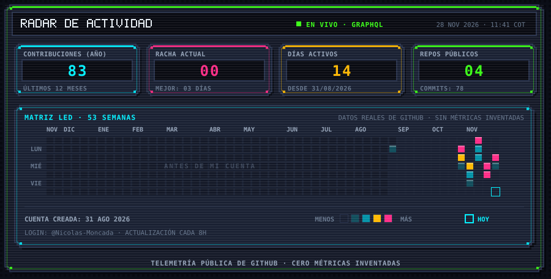

<!--
  PROFILE ENGINE v2.0 · 16-bit Arcade Edition
  Generado automáticamente por scripts/build_all.py (Python + SVG puro).
  Datos reales de GitHub sin métricas inventadas.
-->

<picture>
  <source media="(prefers-color-scheme: dark)" srcset="./assets/hero-dark.svg" />
  <source media="(prefers-color-scheme: light)" srcset="./assets/hero-light.svg" />
  
</picture>

  
    <a href="#stage-01">STAGE 01 · SOBRE MÍ</a> &nbsp;·&nbsp;
    <a href="#stage-02">STAGE 02 · ARSENAL</a> &nbsp;·&nbsp;
    <a href="#stage-03">STAGE 03 · LABORATORIO</a> &nbsp;·&nbsp;
    <a href="#stage-04">STAGE 04 · ACTIVIDAD</a> &nbsp;·&nbsp;
    <a href="#stage-05">STAGE 05 · CONEXIÓN</a>
  

<picture>
  <source media="(prefers-color-scheme: dark)" srcset="./assets/stage-01-dark.svg" />
  <source media="(prefers-color-scheme: light)" srcset="./assets/stage-01-light.svg" />
  
</picture>

**Nicolás Moncada Montaño** · Estudiante de Ingeniería de Sistemas (3er semestre · UNIMINUTO) · Bogotá, Colombia.

Tengo 20 años, vivo en Bogotá y estudio Ingeniería de Sistemas en UNIMINUTO (3er semestre). Uso IA a diario en nivel intermedio y aplico vibe coding para agilizar mi flujo sin saltarme los fundamentos.

Me atraen el desarrollo backend, el IoT, la ciberseguridad y el diseño visual. Programo para resolver problemas concretos y construir proyectos claros y escalables.

**Intereses:** `Videojuegos` · `Música` · `Backend & IoT` · `IA` · `Ciberseguridad` · `Diseño`

<picture>
  <source media="(prefers-color-scheme: dark)" srcset="./assets/stage-02-dark.svg" />
  <source media="(prefers-color-scheme: light)" srcset="./assets/stage-02-light.svg" />
  
</picture>

<picture>
  <source media="(prefers-color-scheme: dark)" srcset="./assets/player-card-dark.svg" />
  <source media="(prefers-color-scheme: light)" srcset="./assets/player-card-light.svg" />
  
</picture>

Ficha técnica accesible (atributos y stack cualitativo)

| Atributo | Enfoque | Nivel |
| :--- | :--- | :---: |
| IA Aplicada | Uso diario en flujo de trabajo | `INTERMEDIO` |
| Vibe Coding | Prototipado ágil con fundamentos | `EN PRÁCTICA` |
| Ciberseguridad | Redes, buenas prácticas y CTF | `APRENDIENDO` |
| Diseño & UI | Pixel art, SVG y diseño visual | `EN PRÁCTICA` |

| Tecnología | Nivel cualitativo |
| :--- | :---: |
| Python | `INTERMEDIO` |
| JavaScript | `EN PRÁCTICA` |
| HTML / CSS | `EN PRÁCTICA` |
| SQL | `APRENDIENDO` |
| PHP | `APRENDIENDO` |
| Git / Actions | `EN PRÁCTICA` |

<picture>
  <source media="(prefers-color-scheme: dark)" srcset="./assets/stage-03-dark.svg" />
  <source media="(prefers-color-scheme: light)" srcset="./assets/stage-03-light.svg" />
  
</picture>

<a href="https://github.com/Nicolas-Moncada/pagina-web">
<picture>
  <source media="(prefers-color-scheme: dark)" srcset="./assets/lab-card-1-dark.svg" />
  <source media="(prefers-color-scheme: light)" srcset="./assets/lab-card-1-light.svg" />
  
</picture>
</a>
<a href="https://github.com/Nicolas-Moncada/Bot">
<picture>
  <source media="(prefers-color-scheme: dark)" srcset="./assets/lab-card-2-dark.svg" />
  <source media="(prefers-color-scheme: light)" srcset="./assets/lab-card-2-light.svg" />
  
</picture>
</a>
<a href="https://github.com/Nicolas-Moncada/avion">
<picture>
  <source media="(prefers-color-scheme: dark)" srcset="./assets/lab-card-3-dark.svg" />
  <source media="(prefers-color-scheme: light)" srcset="./assets/lab-card-3-light.svg" />
  
</picture>
</a>
<a href="https://github.com/Nicolas-Moncada?tab=repositories">
<picture>
  <source media="(prefers-color-scheme: dark)" srcset="./assets/lab-next-4-dark.svg" />
  <source media="(prefers-color-scheme: light)" srcset="./assets/lab-next-4-light.svg" />
  
</picture>
</a>

Índice accesible de repositorios públicos

| Proyecto | Lenguaje | Estrellas | Descripción |
| :--- | :--- | :---: | :--- |
| [pagina-web](https://github.com/Nicolas-Moncada/pagina-web) | PHP | — | Proyecto pagina web |
| [Bot](https://github.com/Nicolas-Moncada/Bot) | Python | — | Repositorio público en desarrollo |
| [avion](https://github.com/Nicolas-Moncada/avion) | JavaScript | — | Repositorio público en desarrollo |

<picture>
  <source media="(prefers-color-scheme: dark)" srcset="./assets/stage-04-dark.svg" />
  <source media="(prefers-color-scheme: light)" srcset="./assets/stage-04-light.svg" />
  
</picture>

<picture>
  <source media="(prefers-color-scheme: dark)" srcset="./assets/contributions-dark.svg" />
  <source media="(prefers-color-scheme: light)" srcset="./assets/contributions-light.svg" />
  
</picture>

Resumen de telemetría pública de GitHub

- **Usuario:** `@Nicolas-Moncada`
- **Contribuciones (año):** 83
- **Racha actual:** 0 días (mejor racha: 3)
- **Días activos:** 14
- **Repositorios públicos:** 4
- **Última sincronización:** `2026-11-28 16:41 UTC`

<picture>
  <source media="(prefers-color-scheme: dark)" srcset="./assets/stage-05-dark.svg" />
  <source media="(prefers-color-scheme: light)" srcset="./assets/stage-05-light.svg" />
  
</picture>

<a href="https://github.com/Nicolas-Moncada">
<picture>
  <source media="(prefers-color-scheme: dark)" srcset="./assets/contact-github-dark.svg" />
  <source media="(prefers-color-scheme: light)" srcset="./assets/contact-github-light.svg" />
  
</picture>
</a>

- **GITHUB:** [@Nicolas-Moncada](https://github.com/Nicolas-Moncada)

<picture>
  <source media="(prefers-color-scheme: dark)" srcset="./assets/footer-dark.svg" />
  <source media="(prefers-color-scheme: light)" srcset="./assets/footer-light.svg" />
  
</picture>

  <!-- LAST_ACTIVE_START -->⚡ <b>Profile Engine v2.0</b> · 83 contribuciones · 14 días activos · racha 0 · 4 repos públicos · sync 28 NOV 2026 · 11:41 COT<!-- LAST_ACTIVE_END -->

